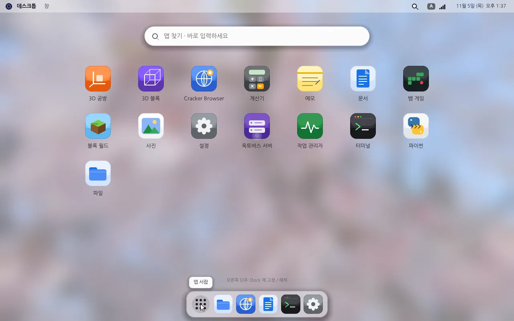
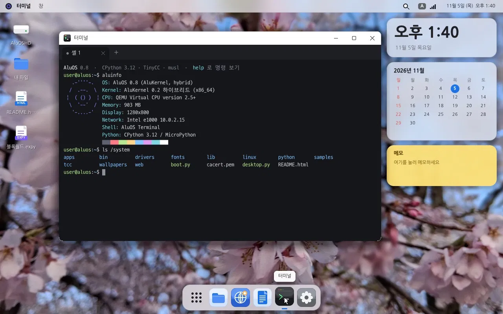
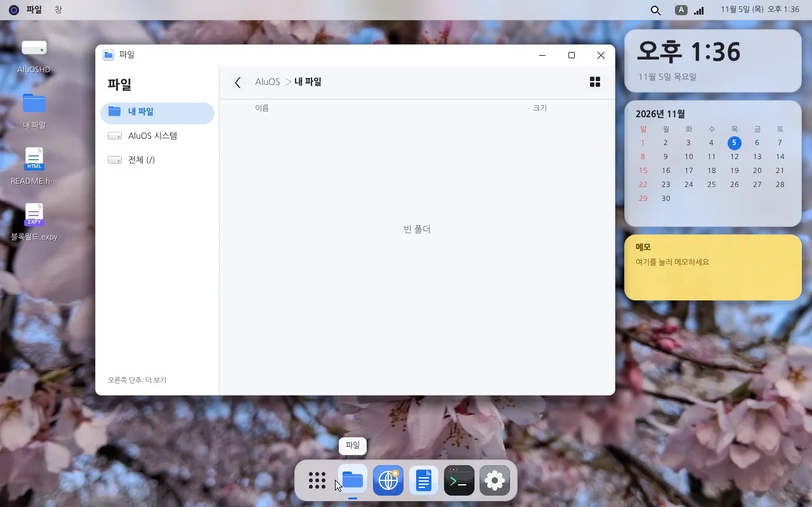
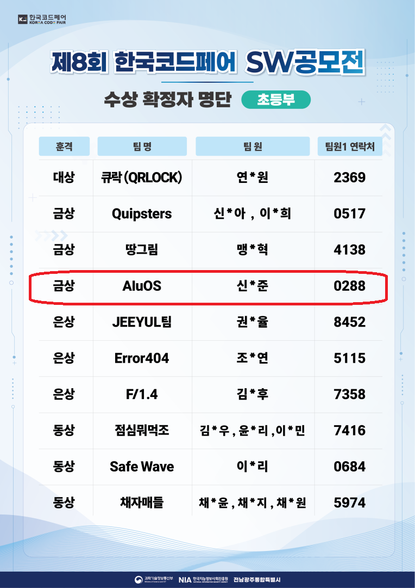

# Uncrater
 Uncrater is a site designed for children, teenagers, and anyone who finds coding complex; it allows users to build an operating system (OS) using block-based coding. The operating systems created are as follows:
.webp>)
.webp>)

It is also possible to create a CMD-based OS. Evidence of this capability is as follows: the AluOS team, winner of the Gold Award in the elementary division at the Korea Code Fair.

